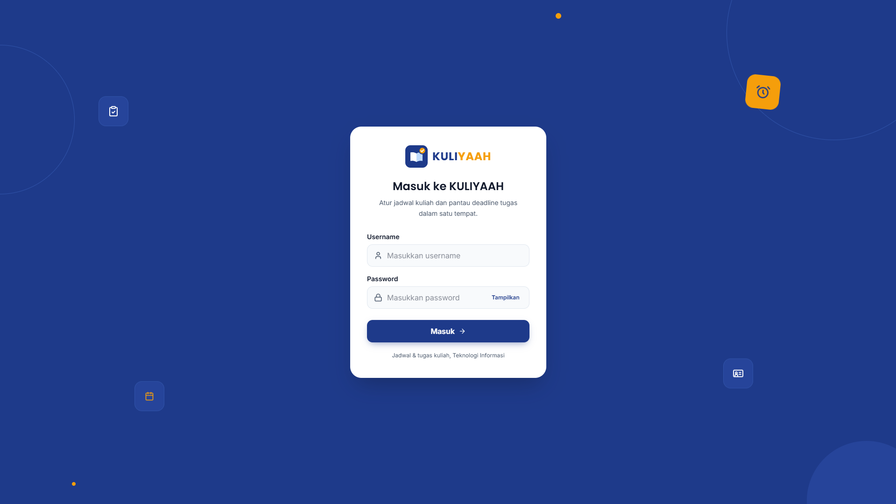
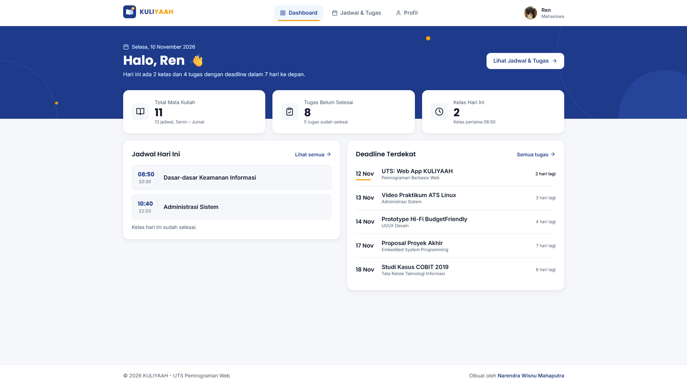
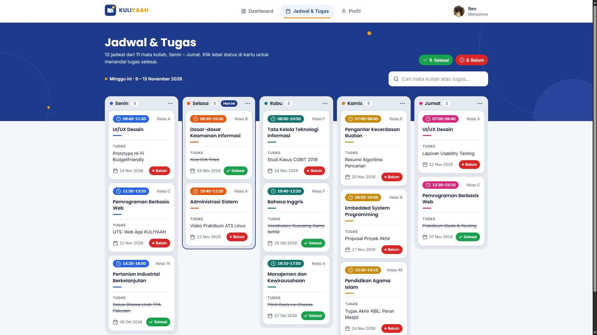
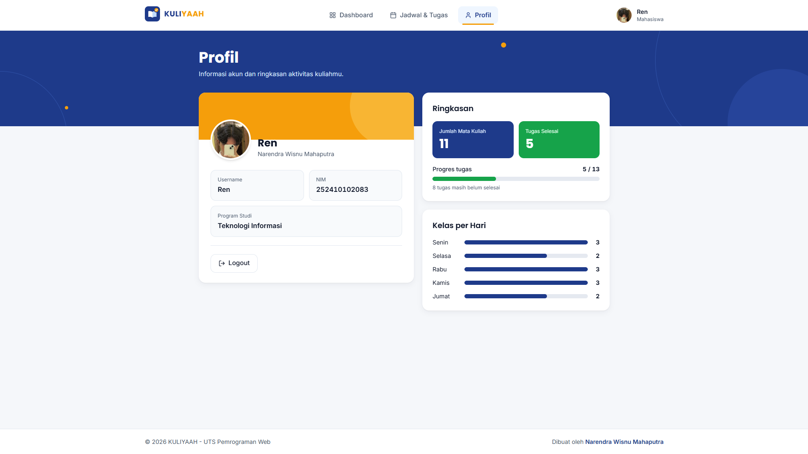
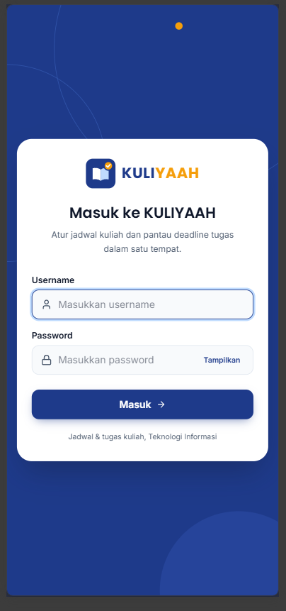
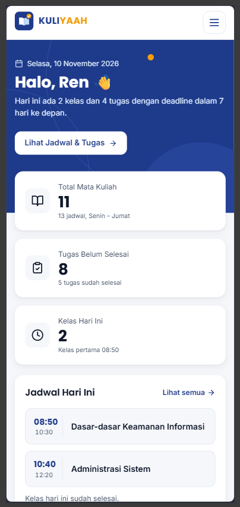
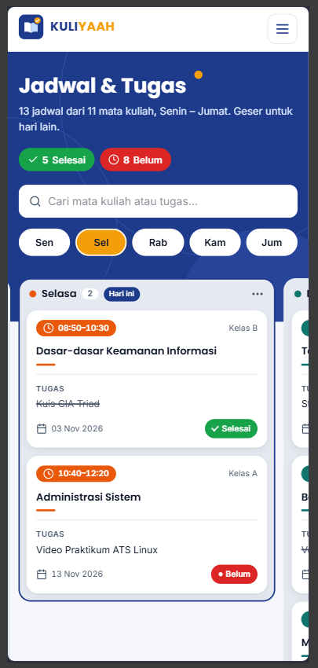
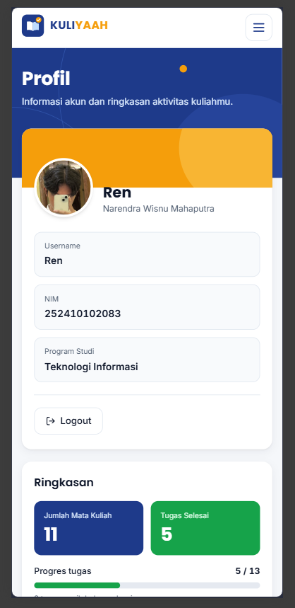

# KULIYAAH

**UTS Pemrograman Web 2026**
Narendra Wisnu Mahaputra · NIM 252410102083 · Teknologi Informasi

KULIYAAH adalah aplikasi web sederhana untuk melihat jadwal kuliah dan memantau deadline tugas mahasiswa Teknologi Informasi. Aplikasi dibuat dengan Laravel memakai pola MVC murni: **tanpa database**, tanpa starter kit, dan semua data berupa array PHP di controller.

## Fitur

- **Login** dengan satu akun yang disimpan sebagai array di controller (tanpa database). Username dikirim ke halaman lain lewat query string `?username=...`.
- **Dashboard**: sapaan sesuai username, tanggal hari ini, ringkasan (total mata kuliah, tugas belum selesai, kelas hari ini), jadwal hari ini, dan 5 deadline terdekat beserta sisa harinya.
- **Jadwal & Tugas**: papan kolom Senin sampai Jumat. Tiap kartu berisi jam, mata kuliah, kelas, tugas, deadline, dan status. Status bisa diklik (Belum ⇄ Selesai), ada pencarian, dan di HP papannya bisa digeser per hari.
- **Profil**: foto, nama, NIM, program studi, ringkasan progres tugas, dan grafik jumlah kelas per hari.
- Animasi halus (transisi antarhalaman, kartu muncul berurutan, count-up angka, bar terisi). Semua animasi mati otomatis kalau pengguna mengaktifkan *reduce motion*.

> Klik status tugas hanya mengubah tampilan di browser (JavaScript DOM). Tidak ada data yang disimpan, jadi setelah halaman dimuat ulang status kembali sesuai array di controller.

## Teknologi

| Bagian | Yang dipakai |
|---|---|
| Framework | Laravel 13 (PHP 8.3+) |
| Template | Blade: `@extends`, `@section`, `@yield`, `@include`, `@foreach`/`@forelse`, komponen `<x-...>` |
| Styling | Tailwind CSS via CDN (`@tailwindcss/browser@4.1.11`) + `public/css/app.css` |
| Interaksi | JavaScript vanilla (`public/js/app.js`) |
| Font | Poppins (judul, logo) dan Inter (teks) dari Google Fonts |
| Data | Array PHP di `PageController` (tanpa database, migration, atau model) |

## Cara Menjalankan

```bash
git clone https://github.com/<username-github>/UTS_PWEB_252410102083.git
cd UTS_PWEB_252410102083
composer install
cp .env.example .env
php artisan key:generate
php artisan serve
```

Buka `http://127.0.0.1:8000`, lalu masuk dengan username `Ren` dan password `Naren1234` (akun disimpan sebagai array di `PageController::dataAkun()`, bukan database).

Catatan: Tailwind dan font dimuat dari internet (CDN), jadi pastikan koneksi internet aktif.

## Struktur File Utama

```
routes/web.php                              -> daftar route bernama (login, dashboard, pengelolaan, profile)
app/Http/Controllers/PageController.php     -> data array + logika tiap halaman
resources/views/layouts/app.blade.php       -> kerangka HTML (head, navbar, @yield('content'), footer)
resources/views/login.blade.php             -> form login (POST + @csrf + @error)
resources/views/dashboard.blade.php         -> halaman Dashboard
resources/views/pengelolaan.blade.php       -> halaman Jadwal & Tugas (papan per hari)
resources/views/profile.blade.php           -> halaman Profil
resources/views/components/navbar.blade.php -> komponen <x-navbar>
resources/views/components/footer.blade.php -> komponen <x-footer>
resources/views/components/logo.blade.php   -> komponen <x-logo> (SVG)
resources/views/components/ikon.blade.php   -> komponen <x-ikon> (ikon SVG)
resources/views/components/kartu-matkul.blade.php -> komponen <x-kartu-matkul>
resources/views/partials/kartu-ringkasan.blade.php -> dipanggil dengan @include di Dashboard
resources/views/partials/hiasan-pita.blade.php     -> hiasan pita header, dipanggil dengan @include
public/css/app.css                          -> CSS animasi dan komponen kecil
public/js/app.js                            -> JavaScript vanilla
public/images/foto-profil.jpg               -> foto profil
```

## Alur Aplikasi

1. `GET /` → `PageController@loginForm` → view `login`.
2. Form login dikirim `POST /login` → `PageController@login` memvalidasi input, lalu redirect ke `/dashboard?username=...`.
3. `GET /dashboard`, `/pengelolaan`, `/profile` → controller mengambil `$request->query('username')`. Kalau kosong, kembali ke login. Kalau ada, controller menyiapkan array data dan mengirimnya ke view.
4. View menampilkan data dengan `@foreach`, dan setiap link navbar membawa `?username=...` supaya username tidak hilang.

## Screenshot

Semua screenshot ada di folder `docs/`.

### Desktop

**Login**: form username dan password. Kalau salah, muncul pesan error dari controller.



**Dashboard**: sapaan sesuai username, 3 kartu ringkasan, jadwal hari ini, dan 5 deadline terdekat.



**Jadwal & Tugas**: papan 5 kolom Senin sampai Jumat, hasil `@foreach` dari array di controller. Status di kartu bisa diklik dan ada pencarian.



**Profil**: foto, username dari query string, NIM, prodi, progres tugas, dan jumlah kelas per hari.



### Mobile

Di layar HP, menu pindah ke tombol hamburger, kartu ringkasan jadi satu kolom, dan papan jadwal bisa digeser per hari lewat tab Sen sampai Jum.

| Login | Dashboard | Jadwal & Tugas | Profil |
|:---:|:---:|:---:|:---:|
|  |  |  |  |
